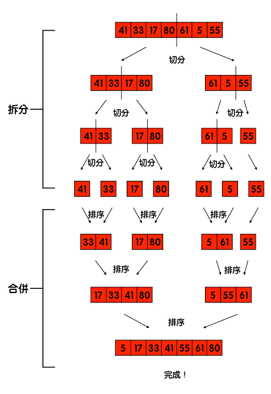

# Space and time complexity
## Time complexity of `set` lookup is $O(1)$

Python 的 `set`（集合）底層由雜湊表（Hash Table）實作，檢查元素是否存在（如 `val in rows[r]`）的**平均時間複雜度為 $O(1)$**，最壞情況為 $O(n)$：

* **雜湊換算直接跳轉（平均 $O(1)$）**：透過 `hash(val)` 將元素直接換算成記憶體「門牌號碼」，不需像 `list` 從頭翻找，無論集合多大都能瞬間定位。
* **雜湊碰撞退化（最壞 $O(n)$）**：當不同元素被分配到同一個儲存桶（Bucket）時，需逐一比對而退化為 $O(n)$；但 Python 會自動擴容並加入隨機雜湊種子，實務上極罕見。

## Time complexity of `sorted()` is $O(n \log n)$

Python 的 `sorted()`（Timsort）核心建立在分治法（Divide and Conquer）的合併排序概念上，其運算量由「層數」與「每層工作量」相乘決定：

* **總共有 $\log n$ 層（對半切分與合併）**：如圖所示，資料每次對半切分、再兩兩合併，從 $n$ 個元素一路切到剩 $1$ 個元素，總共只需經過 $\log_2 n$ 層。
* **每一層都要花 $O(n)$ 時間**：在每一層進行「合併排序」時，都必須把該層所有的 $n$ 個元素逐一比大小並放進新位置。
* **總時間相乘**：$\text{每層 } O(n) \times \text{共 } \log n \text{ 層} = O(n \log n)$。
* **比較排序的理論極限**：只要是透過「兩兩比較元素大小」來排序的演算法，在一般亂序資料下，$O(n \log n)$ 已經是數學上的最快極限。

* 

# Tips on solving problem
## Method for Early Return

eg. 0242_Valid_Anagram

在進行字元頻率統計前，先加上 `if len(s) != len(t): return False` 進行長度預檢，能有效加快實際執行速度，其效益由「讀取成本」與「提前終止」決定：

- **取得字串長度只需 $O(1)$ 時間**：Python 的字串物件在建立時就直接記錄了長度屬性，因此呼叫 `len()` 只需讀取該數值，不需從頭到尾走訪字元。
- **觸發提前終止（Early Return）**：只要兩字串長度不同，程式在進入任何迴圈前就會立刻結束，完全省去後面建立字典與逐字計數的 $O(n)$ 開銷。
- **優化最佳情況（Best Case）**：雖然在最壞情況下（兩字串等長時），整體時間複雜度依然維持 $O(n)$，但這行判斷能讓長度不符的測資在常數時間內瞬間完成。
- **簡化後續迴圈設計**：一旦通過長度檢查，就能確保 `s` 與 `t` 絕對等長，後續若想將兩個 `for` 迴圈合併成單一索引迴圈（同時處理 `s[i]` 與 `t[i]`）也無須擔心索引越界。

## 先建立 `list` 再合併成 `string`

eg. 0271_Encode_and_Decode_Strings

Python 的字串是**不可變的 (Immutable)**。若用 `res += new_str` 反覆相加，每次都會在記憶體重新複製整段字串，時間複雜度為 $O(N^2)$；先 `list.append()` 再一次 `"".join()`，時間複雜度只需 **$O(N)$**。